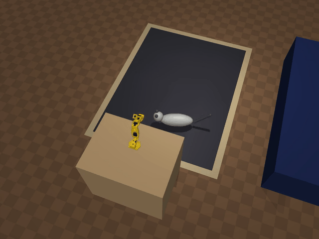
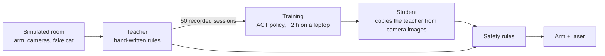
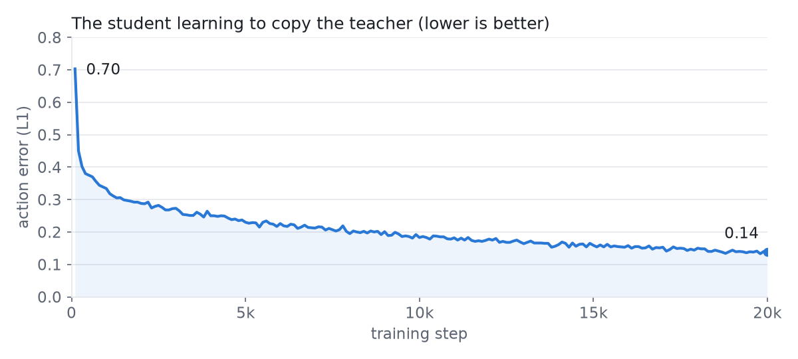
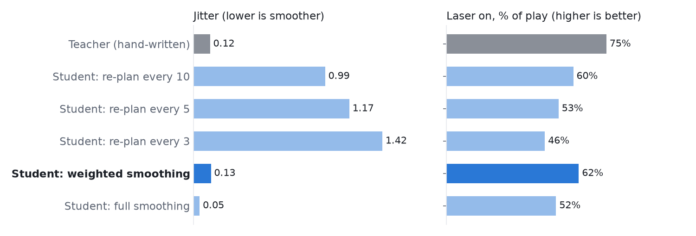

# LeKitten

Teaching a small robot arm to play laser pointer with my two cats, and learning how robot training works along the way.

> **Status: simulation only.** Everything here runs in a physics simulator. The real arm (an [SO-101](https://github.com/TheRobotStudio/SO-ARM100)) hasn't been used yet; that's the next stage.



## What this is

An SO-101 robot arm holds a low-power laser pointer (Class 2, under 1 mW) and points the dot at the floor to play with cats: it leads them around, never shines on them, and stops calmly at the end.

Before touching real hardware, I built a simulated version of my living room and used it to learn the standard robot-learning loop with [LeRobot](https://github.com/huggingface/lerobot):

1. **Write a teacher by hand.** A rules-based player that leads a fake cat around the rug.
2. **Record the teacher** playing 50 sessions, as camera images plus arm movements.
3. **Train a neural network** (the student) to copy the teacher from those recordings, using only what the cameras see.
4. **Compare** the student with the teacher on cats neither has seen.

## How it works



- **The simulator** is [MuJoCo](https://mujoco.org). It has the arm, a desk camera, a camera on the arm's wrist, a laser that makes a red dot where it hits, and a fake cat that wanders, dashes, stalks and pounces on the dot.
- **The teacher** keeps the dot about 40 cm ahead of the cat, circles and freezes, and jumps the dot away when the cat catches it.
- **The student** is an [ACT](https://huggingface.co/papers/2304.13705) policy (51.6 M parameters). It sees the two camera images and the arm's joint angles, and outputs where to move the arm next.
- **Safety rules sit outside both.** Every move from the teacher or the student is checked first. The beam must point down, never at or across a cat, never toward where people sit on the couch, and the laser turns off if no cat is seen. A trained model can be wrong, so it never controls the laser directly.

## Results so far (simulation)

Trained on 50 recorded sessions (40 minutes of demonstrations) for 20,000 steps on a MacBook Air (Apple M5 GPU), in about 1 h 45 min. Tested on 20 sessions with cats neither the teacher nor the student had seen.



| | Teacher (hand-written) | Student (trained) |
|---|---|---|
| Laser on (rest of the time safety blocked it) | 75% | 62% |
| Dot in the "chase zone" (35–70 cm from the cat) | 24% | 30% |
| Dot too close to the cat (blocked by safety) | 10% | 22% |
| Jitter (how jerky the arm moves; lower is smoother) | 0.12 | 0.13 |

The student is shown with weighted smoothing (explained below).

**What I learned**

- **The student learned to chase.** It keeps the dot in the chase zone slightly more than the teacher.
- **Its main weakness: it gets too close to the cat**, about twice as often as the teacher (safety stops it every time). In the desk camera the cat is only about 15 pixels long, so the student misjudges distance. Lesson: **look at your data before you train.**
- **The student's arm was jittery at first.** ACT plans 100 moves ahead but only carries out a few before planning again, and the arm jumps a little at every switch. Re-planning *more* often made it worse. Averaging the overlapping plans, with the newest counting most ("weighted smoothing", one setting, no retraining), made it as smooth as the teacher and kept the laser on the most:



## Run the same experiment

Tested on a Mac with Apple Silicon. It should also work on Linux with an NVIDIA GPU (use `--policy.device=cuda`); that hasn't been tested yet. The commands use the public **sample room**, so you don't need a scan of your own home.

**1. Set up** (about 10 minutes)

```bash
git clone https://github.com/rootyhub/LeKitten.git && cd LeKitten
conda env create -f environment.yml        # Python 3.12, LeRobot, MuJoCo
conda activate lerobot
pytest                                      # safety, aiming and zone checks, should all pass
```

**2. Watch the teacher play**

```bash
mjpython -m lekitten.play --backend sim     # opens a 3D window (on macOS use mjpython, elsewhere python)
```

**3. Record demonstrations** (50 sessions, about 30 minutes)

```bash
python -m lekitten.record --episodes 50 --duration 45 --root datasets/sample_room
```

**4. Make a smaller copy for faster training** (320×240 images)

```bash
python -m lekitten.tools.downscale_dataset datasets/sample_room datasets/sample_room_320
```

**5. Train the student** (20,000 steps, about 1 h 45 min on an M5 MacBook Air; keep it plugged in, as the GPU is about 2× slower on battery)

```bash
lerobot-train \
  --dataset.repo_id=local/sample_room_320 --dataset.root=datasets/sample_room_320 \
  --policy.type=act --policy.device=mps --policy.n_action_steps=10 \
  --accelerator.mixed_precision=bf16 --num_workers=4 --batch_size=8 \
  --steps=20000 --save_freq=5000 \
  --policy.push_to_hub=false --trackio.enable=false \
  --output_dir=outputs/train/student
```

**6. Watch the student play**

```bash
mjpython -m lekitten.policy_play --policy outputs/train/student/checkpoints/last/pretrained_model --ensemble -0.1
```

**7. Compare it with the teacher** (20 unseen cats, side-by-side video of the first)

```bash
python -m lekitten.evaluate --policy outputs/train/student/checkpoints/last/pretrained_model \
  --ensemble -0.1 --episodes 20 --video outputs/compare
```

`--ensemble -0.1` is weighted smoothing. Leave it out to see the jittery version. Everything is saved in `datasets/` and `outputs/`, which stay on your computer (git-ignored).

### Use your own room (optional)

Scan the room with a LiDAR phone app (I used [Polycam](https://poly.cam), exported as OBJ) and put it in `sim/private_scan/` (git-ignored, so your home stays private). Then:

```bash
python -m lekitten.tools.import_scan "sim/private_scan/<scan>.obj" --origin X Y   # X Y = a corner of the play area
python -m lekitten.tools.show_room --room living_room --snapshot
python -m lekitten.tools.reach_map --room living_room                             # where can the dot reach from each arm spot?
```

Then fill in the `living_room` entry in `config.yaml` (arm spots, camera, rug, couch) and add `--room living_room` to the commands above. My own results above came from my scanned living room.

## What's in the repo

| Folder / file | What it is |
|---|---|
| `lekitten/play.py` | The teacher: hand-written play rules |
| `lekitten/record.py` | Records the teacher as a LeRobot dataset |
| `lekitten/policy_play.py` | Runs a trained student, with the same safety rules |
| `lekitten/evaluate.py` | Teacher vs student on the same unseen cats |
| `lekitten/safety.py` | The safety rules (and `tests/` tries to break them) |
| `lekitten/aim.py`, `kinematics.py` | Works out the arm angles that put the dot on a given spot |
| `backends/sim/` | The simulated arm, cameras, laser and fake cat |
| `backends/real/` | The real arm, USB relay laser and webcam (written, only tested without hardware) |
| `sim/scenes/sample_room.xml` | The public sample room |
| `config.yaml` | Every position and setting, used by both sim and real |
| `docs/real-robot.md` | The plan for moving to the real arm |
| `CLAUDE.md` | The project's rules (built with [Claude Code](https://claude.com/claude-code)) |

## Next

- Run it on the real SO-101 ([plan](docs/real-robot.md)): calibrate, check that the real arm matches the sim, correct for the fisheye camera lens.
- Train a cat detector on real footage, so the real arm can see the cats.
- Record real demonstrations by hand with the SO-101 leader arm and train on those.
- Give the student a better view of the cat (the 15-pixel problem) and see if it stops getting too close.

## Credits

- [LeRobot](https://github.com/huggingface/lerobot) (Hugging Face) for datasets, ACT and training; [MuJoCo](https://mujoco.org) for simulation.
- SO-101 model (`sim/models/so101/`): [The Robot Studio SO101 MJCF](https://github.com/google-deepmind/mujoco_menagerie/tree/main/robotstudio_so101) from MuJoCo Menagerie, Apache License 2.0 (its LICENSE is kept alongside the model).
